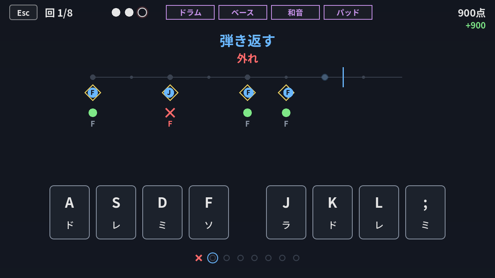
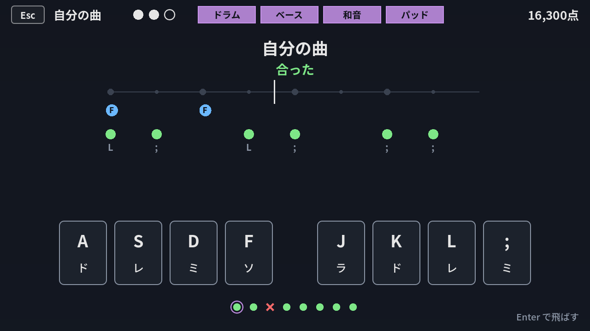
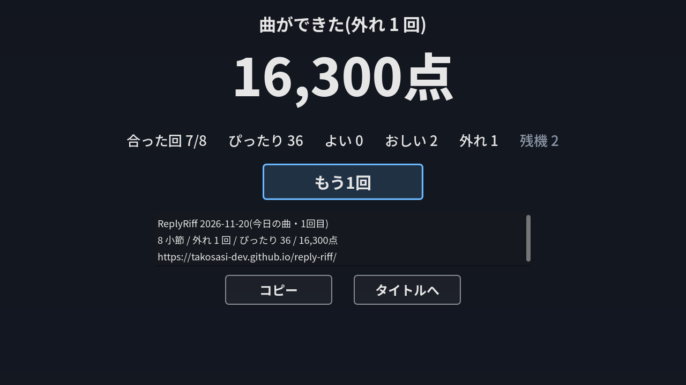

# ReplyRiff

1 小節のフレーズが鳴ります。次の小節で、同じフレーズをキーボードで弾き返します。**A S D F J K L ;** の 8 キーが「ド レ ミ ソ ラ ド レ ミ」の鍵盤です。合っていると伴奏の楽器が 1 つ増えて曲が育ち、8 回を終えると、自分が弾いたフレーズをつないだ 1 曲が流れます。ブラウザで開くだけで遊べます。

**▶ 遊ぶ: https://takosasi-dev.github.io/reply-riff/** (デスクトップの Chrome・Edge・Firefox。キーボードで遊びます。インストール不要。音を出して遊んでください)

> **試作です。** 押してから音が出るまでの遅れを、まだ本物のブラウザで測っていません。測って遅ければ(Chrome で 80 ms を超えれば)、公開をやめることがあります。

| 弾き返した後(◇ がお手本、青い丸が押した位置) | 自分の曲 | 結果 |
|---|---|---|
|  |  |  |

## 遊び方

- 1 曲は 60 秒です(テンポ 100、伴奏は C・Am・F・G のくり返し)。数えの 1 小節の後、「お手本を聞く」と「弾き返す」を 8 回くり返します。
- お手本の小節で鳴ったフレーズを、次の小節で同じ音・同じリズムで弾き返します。
- 1 回目は F だけの「タン・タン・タタン」。回が進むと、使うキー・音の数・リズムの細かさが 1 つずつ増えます。
- お手本の間は、鳴っている音のキーの縁が光ります。5 回目からは 1 音目だけ、7 回目からは光りません(耳で覚えます)。
- 見出しが黄色の間はお手本、青の間が自分の番です。弾き返すと、押した位置が目盛りの下に青い丸で出ます。判定の後は、お手本の位置(◇)と並べて比べられ、その下に音ごとの段(● ぴったり、◐ よい、○ おしい、× 外れ)とお手本のキーが出ます。
- 合うと伴奏の楽器が 1 つ増えます(ドラム → ベース → 和音 → パッド)。外れると残機(3)が 1 つ減り、0 で曲が止まります。
- 8 回を終えると「自分の曲」が流れます。合った回は自分が弾いた音で、外れた回はお手本が薄い音で鳴ります。Enter で飛ばせます。

### 判定

- 1 音目だけは拍との差を見ます(±180 ms)。
- 2 音目からは、**押した間隔とお手本の間隔の差**で見ます(45 ms 以内「ぴったり」、90 ms 以内「よい」、150 ms 以内「おしい」)。音や入力の遅れが一定なら打ち消し合うので、タイミング合わせの設定はありません。
- 音の高さが違う・数が足りない・多い時は外れです。

点 = 音ごとの段(ぴったり 300 / よい 200 / おしい 100)+ 合った回 500(全部ぴったりならさらに 300)。最大 18,100 点。

## 操作

| キー | 動き |
|---|---|
| A S D F J K L ; | 鍵盤(ド レ ミ ソ ラ ド レ ミ)。配列の印字ではなく、キーの位置で決まります |
| Esc | 一時停止(続けると、今の回のお手本の 1 小節前から) |
| Enter | 自分の曲を飛ばす |
| ↑ ↓・Enter・Space | メニュー |
| R | 結果画面でもう 1 回 |

## 今日の曲

「今日の曲」は日付で決まり、同じ日なら誰でも同じフレーズです。結果画面の文字をコピーして貼れば比べられます。「練習」は毎回ちがうフレーズです。

```
ReplyRiff 2026-11-19(今日の曲・1回目)
8 小節 / 外れ 1 回 / ぴったり 31 / 12,400点
https://takosasi-dev.github.io/reply-riff/
```

## しくみ

- **ゲームの決まりは `core/` にだけ**あります(時間割・フレーズ・判定・点・層・残機・自分の曲)。画面と音は `sim.snapshot()` と `sim.events()` を読んで描き、鳴らすだけです。
- 1/120 秒刻みで進め、入力はキーの番号(整数)だけを受けます。進める量は、伴奏の再生の位置から決めます(お手本の音と伴奏がずれないように)。
- 伴奏の 4 層は `AudioStreamSynchronized` で同時に鳴らし、層の音量で足します。音は全部 `tools/gen_audio.py` で合成した物です(外の音源は使っていません)。
- 保存はブラウザの中(localStorage の `reply-riff/save`)だけです。サーバーとの通信やアクセス解析はありません。

## 動作環境

- Godot 4.7.2-stable(GDScript、レンダラー Compatibility)
- Web 書き出しはスレッド無し・拡張無し

## 開発

```
# テスト(全件成功で終了コード 0)
godot --headless --import
godot --headless --script res://tests/run_tests.gd

# Web 書き出し(書き出しテンプレート 4.7.2 が要る)
godot --headless --export-release "Web" build/web/index.html

# 窓なしで S0 → 今日の曲 → 結果 → もう1回 → 結果 を自動で通す
python tools/gd.py smoke 300000 --auto

# Web 書き出しを窓なし・消音の Chrome で一通り確かめ、画面を build/web_shots/ に撮る(Node.js 22 以降)
node tests/web/check.mjs

# 音を作る・字体を画面の文字に絞る(Python)
python tools/gen_audio.py
pip install fonttools
python tools/subset_font.py
```

`main` に push すると、GitHub Actions がテスト → Web 書き出し → GitHub Pages への配置を行います(`.github/workflows/pages.yml`)。

## 開発状況

v0.2.0。人が遊ぶ確かめは、まだしていません。

- 窓なしの Chrome(音は消したまま)で、起動から S0 → タイトル → 設定 → 今日の曲 → 一時停止 → 結果 → もう1回 → 練習を、本物のキーのイベント(CDP)で一通り確かめました(`node tests/web/check.mjs`)。コンソールのエラー 0 件、読み込みの後の通信 0 件。
- 伴奏の時計(曲の位置)とブラウザの音の時計(AudioContext)の差は、60 秒で 20 ms 未満しか動きませんでした(窓なし Chrome の値)。4 層どうしのずれは、1 つのプレイヤーで同じ長さ・同じくり返しで鳴らす作りでそろうはずですが、録音では確かめていません。
- 押してから音が出るまでの遅れ(80 ms を超えたらやめる)は、スピーカーと録音が要るので、まだ判定していません。調整値(窓と段の幅)が遊べる値かも、人が遊んでいないので未判定です。
- 本物のキーボードでの両手の同時押し、Edge・Firefox、音を耳で聞いての確かめも未確認です。

## ライセンス

MIT(`LICENSE`)。同梱の字体は SIL Open Font License 1.1 です(`THIRD-PARTY-NOTICES.md`)。
